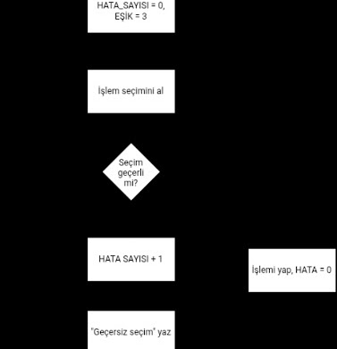

# kod_asistanim
**Proje Yazarı:** Esma Ökçe

# Projenin Adı: Kod-Asistan v0.1

## Projenin Amacı
Kullanıcılara günlük işlerinde (hesaplama, selamlama vb.) yardımcı olacak bir dijital asistan tasarlamak.

## Projenin Hedefleri
- v0.1: Temel selamlama ve dört işlem hesaplama
- v1.0: Akıllı Menü (kullanıcı seçimine göre yönlendirme)
- v2.0: Veri Saklama (kullanıcı adı ve geçmiş işlemlerin kaydı)

## Projenin Kapsamı
Asistan, kullanıcıdan aldığı girdiyi kontrol eder. Kritik eşik mantığı:

BAŞLA
  Kullanıcıdan "isim" al 
  Kullanıcıdan "soyad" al
  "isim"+"soyad"
   Yaz "Hoş geldin "isim"+"soyad""
BİTİR
## Akış Şeması

## Kaynakça
- Milli Eğitim Bakanlığı. *Algoritmik Düşünme ve Tasarım* [Ders Kitabı]. (Yayınevi, yıl)